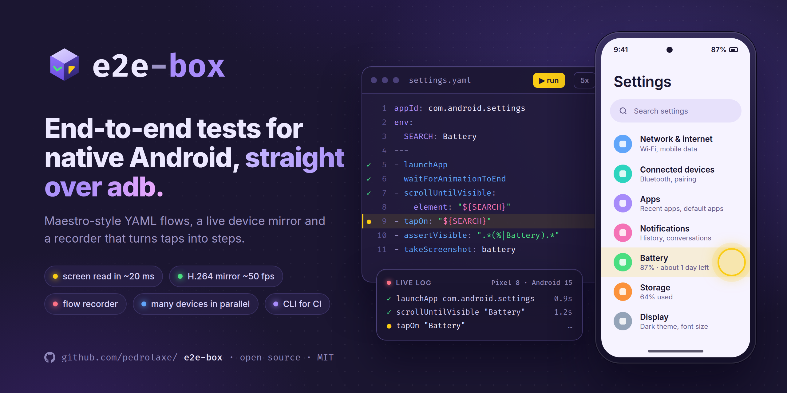

<p align="center">
  <picture>
    <source media="(prefers-color-scheme: dark)" srcset="https://raw.githubusercontent.com/pedrolaxe/e2e-box/main/assets/logo-dark.svg">
    
  </picture>
</p>

<p align="center">
  End-to-end testing for native Android apps <strong>over adb</strong>, with Maestro-style YAML flows.<br>
  A local Next.js dashboard with live device mirroring, a live log, a step queue and a flow recorder.
</p>

<p align="center">
  
  
  
  <a href="LICENSE"></a>
</p>

<p align="center">
  
</p>

## Getting started

**Just the CLI** (in your app's repo, or in CI):

```bash
npx e2e-box            # runs the flows in .e2e-box/ or .maestro/
```

**The dashboard** (mirror, recorder, editor) runs from a clone:

```bash
git clone https://github.com/pedrolaxe/e2e-box.git && cd e2e-box
pnpm install
pnpm dev            # http://127.0.0.1:3334
```

Requirements: `adb` (Android SDK platform-tools) and an Android device with **USB debugging** turned on (or an emulator).
adb is looked up in `ADB_PATH`, `ANDROID_HOME`, `%LOCALAPPDATA%\Android\Sdk` and finally on the `PATH`.

The dashboard is available in **English** and **Brazilian Portuguese**: the EN/PT switch at the top changes it and remembers
your choice; without one, it follows the browser language. The engine log and the CLI output are in Portuguese for now.

## On-device agent

To read the screen quickly, e2e-box pushes a small agent (`agent/dist/e2e-box-agent.jar`, ~5KB) to
`/data/local/tmp` and runs it with `app_process` (no APK install). It keeps the accessibility connection
open and answers in ~20ms, versus 1–3s for `uiautomator dump`; it also types **accented** text straight into
the focused field (no ADBKeyboard needed). It starts on the first screen read and is pushed again when the jar changes.

- With the agent, the engine waits for the **screen to settle** (two identical reads) after each action instead of
  fixed pauses. Without it (`E2E_BOX_NO_AGENT=1`, or if it fails to start), it falls back to `uiautomator dump` and pauses.
- While the agent is connected, an external `uiautomator dump` does not work (only one client at a time).
- Security: each session starts its own agent (stopping previous ones) with a random socket name and secret;
  the agent only accepts connections from `shell`/root, and both sides prove the secret via HMAC before any
  command. Other apps on the device cannot read the screen or receive what is typed.
- Only one process runs flows per device: the dashboard and the CLI would kill each other's agent. Whoever comes second
  gets a notice saying who is running, and the inspector and recorder stay locked on that device until it finishes.
- Rebuild after changing `agent/src`: `node agent/build.mjs` (JDK 17+ and Android SDK with build-tools).

## Workspaces

`e2e-box.config.json` lists the flow folders. It ships with **Exemplos** (`./flows`), which opens Settings and runs
on any Android device.

For your app, the best setup is to keep the flows in the app's repo, in **`.e2e-box/`** or **`.maestro/`**, and clone
e2e-box next to it. The `+` in the sidebar suggests sibling folders (pointing to whichever of `.e2e-box/` or `.maestro/`
already exists) and detects the `appId` of Expo/React Native apps; or edit the file:

```json
{ "id": "my-app", "name": "My app", "dir": "../my-app/.maestro", "appId": "com.company.myapp" }
```

With no `workspaces` in `e2e-box.config.json` (or no file at all), e2e-box looks for `.e2e-box/` and `.maestro/` in the
folder it runs from and uses each one as a workspace, with the `appId` from `app.json`. A `config.yaml` at the root of the
folder (Maestro's workspace config) is not listed as a flow.

Test usernames and passwords go in `e2e-box.local.json` (kept out of git), per workspace; see `e2e-box.local.example.json`.

Files in subfolders show up as subflows (called with `runFlow`).

## Creating flows from the dashboard

1. `+` on a workspace creates the file.
2. On the mirror, pick a mode:
   - **Inspect**: clicking shows the element (text, desc, id) and suggests steps (`tapOn`, `assertVisible`, `point`).
   - **● Record**: every tap/swipe goes to the device **and** becomes a YAML step at the cursor line.
     - Vertical scrolling becomes `scrollUntilVisible` up to the element of the next tap (or `scroll` if there is none).
     - Text that changes becomes a regex: a greeting with a name (`"Hello .*"`) goes in that way; numbers (`"Orders \(\d+\)"`) are offered as an option.
     - Tapping a text field focuses the "type on the device" box, and whatever you type becomes `inputText`.
     - Stop with **■ Stop and save**, the **■ REC** badge on the screen, or **Esc** (saves the YAML).
   - **Control**: just controls the device.
3. The "type on the device" field generates `inputText`; the back/hide keyboard/↵ buttons generate `back`/`hideKeyboard`/`pressKey`.
4. `Ctrl+S` saves, `Ctrl+Enter` runs. If the `---` between the header and the steps is missing, e2e-box adds it.

The mirror uses **video** (`screenrecord` in H.264, decoded in the browser with WebCodecs, ~20–50 fps) and falls back
to **screenshots** (`screencap`, ~1 fps) if the browser does not support it or the video fails; the button under the device
switches between them. Only one video at a time: the tab that opens the video keeps it, the other switches to screenshots and
takes the video back when you return to it.

Each run is stored in `runs/<date>/` with a `report.json`; on failure, also `falha.png` and `falha-hierarquia.xml`.

## Trusting your tests

- **Passed without checks**: if no step verified the result, the dashboard shows "Passed without checks" instead of green, and
  the CLI warns. `assertVisible`, `assertNotVisible`, `assertTrue` and `extendedWaitUntil` count; checks done by the precondition do not.
- **Fragile steps**: the editor flags `tapOn: ""`, the screen root (`id: action_bar_root`) and taps by `point`. When the flow runs,
  the engine reads the element under the tap and the editor offers to replace the step with a text selector.
- **Precondition**: `onFlowStart` in the header runs before the steps. If it fails, the error says the precondition was not met
  instead of the flow tapping around on the wrong screen. Example: `onFlowStart: [{ runFlow: subflows/go-home.yaml }]`.
- **Run part of a flow**: with the cursor on a step, **▶ Step N** runs only that step and **▶ From here** runs to the end, on
  whatever screen the device is on (without `onFlowStart`). Partial runs do not change the flow's status dot in the list.
- **Run details**: clicking a run opens its timeline, with a screenshot per step, each step's log and, on failure, the error and
  what was on screen. Screenshots are kept for the 30 most recent runs; the CLI does not take them.
- **Flakiness**: the **5x** button runs the flow five times in a row and shows how many passed and which step failed.

## Multiple devices, cables and rotation

- **Multiple devices**: each one has its own run. Pick the device at the top and run; when you switch, the dashboard shows the
  other device's log and steps, and the list marks which ones are `running`. The mirror shows one device at a time.
- **Device disconnected**: the flow stops immediately with a disconnected-device error (no waiting for timeouts, no `retry`,
  no evidence). The dashboard waits for the same device to come back, and the mirror and agent reconnect on their own.
- **Rotated screen**: the engine tracks rotation on every step (`%` points and "on screen" checks) and the mirror reopens in
  landscape, with taps landing in the right place.

## CLI (CI / terminal)

Published on npm with no dependencies: it only needs Node 18+ and `adb`. Use `npx e2e-box`, or add it to your app with
`npm i -D e2e-box` and call `e2e-box` from a script. Inside the e2e-box repo, `pnpm e2e` runs the same CLI from source.

```bash
npx e2e-box                       # no target: the .e2e-box/ and .maestro/ folders in the current directory
npx e2e-box .maestro/login.yaml
npx e2e-box .maestro/ -e USER=test -v
npx e2e-box .maestro/ --all-devices   # on every connected device, at the same time
npx e2e-box my-app:login.yaml     # <workspace>:<file>, with an e2e-box.config.json
```

Exits with code 1 if any flow fails and 2 if it cannot start (no device, or the device is busy).
`-d <serial>` picks the device; repeat it for several, or use `--all-devices`. Each device runs the flows in sequence,
devices run in parallel, and each output line starts with the serial. Evidence for failed runs goes to `runs/`.

### GitHub Actions

```yaml
name: e2e
on: [push]
jobs:
  android:
    runs-on: ubuntu-latest
    steps:
      - uses: actions/checkout@v4
      - uses: actions/setup-node@v4
        with:
          node-version: 22
      - name: Enable KVM
        run: |
          echo 'KERNEL=="kvm", GROUP="kvm", MODE="0666", OPTIONS+="static_node=kvm"' | sudo tee /etc/udev/rules.d/99-kvm4all.rules
          sudo udevadm control --reload-rules
          sudo udevadm trigger --name-match=kvm
      - uses: reactivecircus/android-emulator-runner@v2
        with:
          api-level: 34
          arch: x86_64
          script: |
            adb install -r app-release.apk   # your build
            npx e2e-box
      - uses: actions/upload-artifact@v4
        if: failure()
        with:
          name: e2e-runs
          path: runs/
```

## Supported commands

| Command | Notes |
|---|---|
| `launchApp` | `appId`, `clearState`, `stopApp`, `permissions` (grants the denied ones) |
| `stopApp`, `killApp`, `clearState` | |
| `tapOn`, `doubleTapOn`, `longPressOn` | text, `id`, `index`, `point: "50%,89%"`, `repeat`, `optional`, relative (`below`, `above`, `leftOf`, `rightOf`, `childOf`, `containsChild`) |
| `inputText`, `inputRandom*`, `eraseText`, `copyTextFrom`, `pasteText` | accents through the agent; without it, through [ADBKeyboard](https://github.com/senzhk/ADBKeyBoard) if it is the active keyboard, or without accents (with a warning). Text from `${VAR}` shows as `•••` in the log |
| `pressKey`, `back`, `hideKeyboard` | Enter, Back, Home, Backspace, Tab, Escape, Volume… |
| `scroll`, `swipe`, `scrollUntilVisible` | `direction`, `start`/`end`, `from`, `timeout`, `visibilityPercentage` |
| `assertVisible`, `assertNotVisible`, `assertTrue`, `extendedWaitUntil` | waits up to `lookupTimeoutMs` (7s) |
| `runFlow` | `file`, `commands`, `when: visible/notVisible/platform`, `env` |
| `repeat`, `retry` | `times`, `while`, `maxRetries` |
| `waitForAnimationToEnd`, `takeScreenshot`, `openLink` | |
| `wait: 1000` | e2e-box extension (pause in ms) |

Variables: `${NAME}` comes from the header's `env:`, the workspace `env`, `runFlow`, or the env field in the dashboard / `-e` in the CLI.
Text matching works like Maestro: a case-insensitive regex that must match the whole text, against `text`, `content-desc` and `hint`.

Not supported yet (skipped with a warning): `evalScript`, `runScript`, `setLocation`, `travel`, `addMedia`, video recording and AI commands.

Security: the API only accepts calls from its own page (local Host, the app's Origin and JSON); workspaces must live inside
the folder that contains e2e-box, and subflows inside their workspace.

## License

[MIT](LICENSE)
